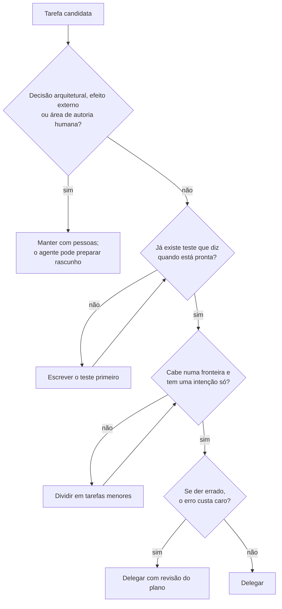
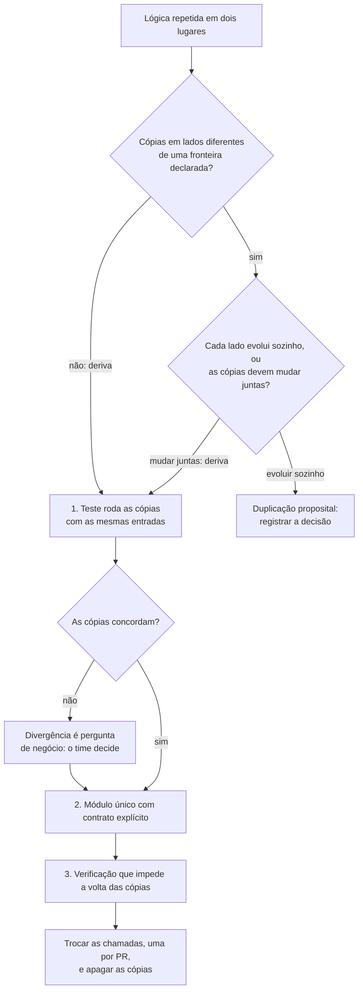
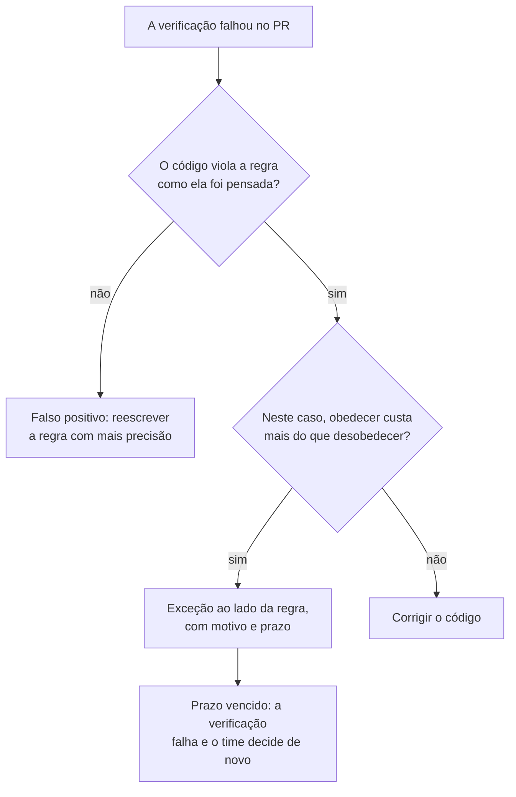
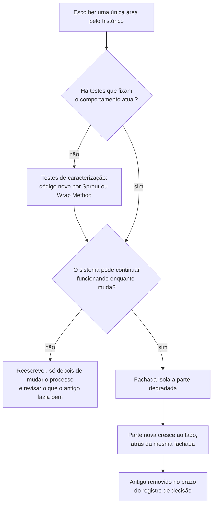
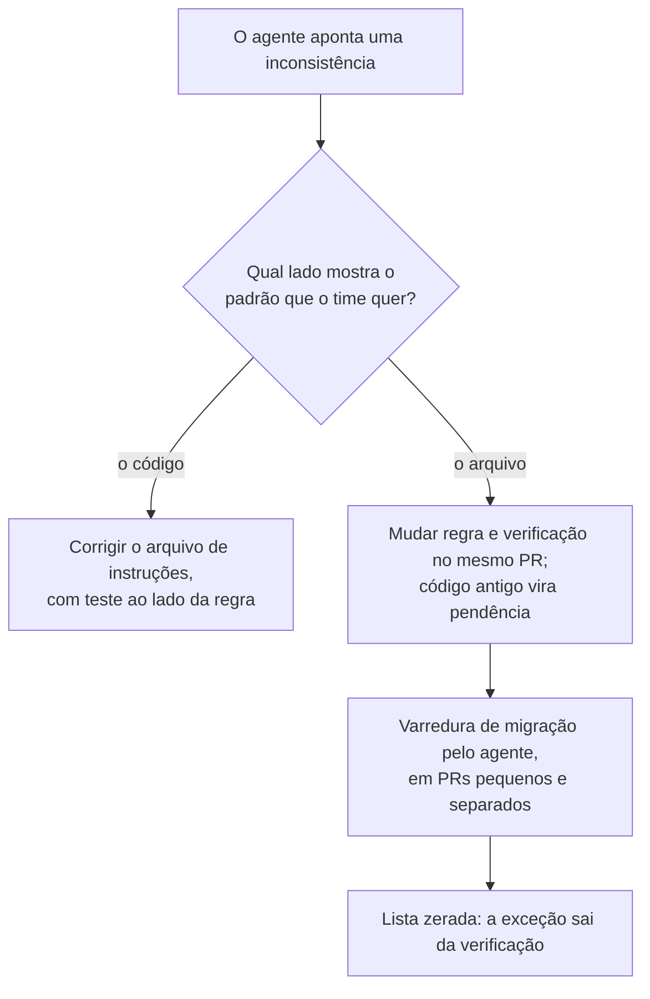

# Fluxogramas de decisão

Versões em Mermaid das figuras do livro. O GitHub desenha os
diagramas direto na página. A ordem das perguntas é do autor; os
critérios vêm dos capítulos indicados.

## Delegar ou manter com pessoas (Cap. 12)

## Duplicação proposital ou deriva (Caps. 6 e 13)

## Quando a verificação barra um PR (Cap. 11)

## Roteiro de resgate (Cap. 13)

## Arquivo de instruções e código discordam (Cap. 9)

